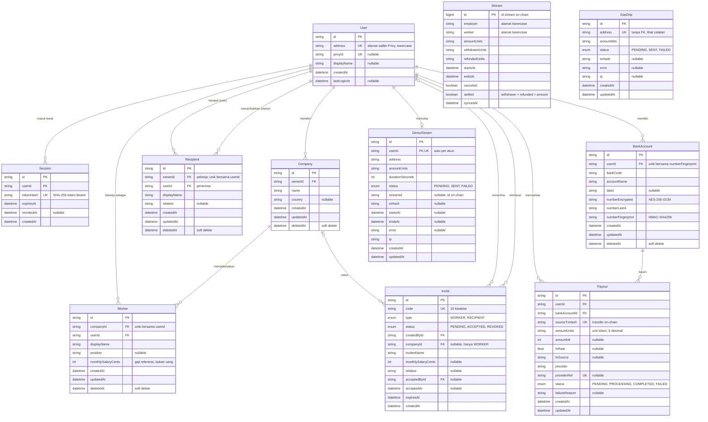

# ERD Database Trickle

Skema Postgres milik API (`apps/api`), sesuai [`apps/api/prisma/schema.prisma`](../apps/api/prisma/schema.prisma) dan migrasi di `apps/api/prisma/migrations/`. Dokumen ini memenuhi K2 (data persisten dengan skema dan relasi yang jelas). Kalau skema berubah, file ini ikut diperbarui di PR yang sama; `apps/api/test/erd.test.ts` gagal kalau ada tabel, kolom, atau migrasi yang belum tercantum di sini.

Terakhir diperbarui: 13 Okt 2026 (indexer stream).

## Prinsip

- **Uang tidak disimpan di database.** Saldo, jumlah yang sudah mengalir, dan penarikan selalu dibaca dari kontrak `TricklePayroll` di Monad testnet (PLAN §4.2). Postgres hanya menyimpan metadata: siapa bekerja di mana, siapa penerima siapa, undangan, rekening bank, dan log operasional. Satu-satunya pengecualian adalah `Stream`, yaitu **cache** stream on-chain yang diisi indexer supaya API bisa mencari stream per employer/pekerja. Isinya selalu disalin dari kontrak, tidak pernah ditulis dari input pengguna. Pengecekan yang memblokir aksi (hapus pekerja) membaca ulang stream kandidat langsung dari chain.
- **Peran tidak disimpan sebagai kolom.** Employer, pekerja, dan penerima diturunkan dari relasi (`Company`, `Worker`, `Recipient`), jadi peran tidak bisa berbeda dengan datanya.
- **Data sensitif tidak pernah disimpan sebagai teks biasa.** Token sesi disimpan hash-nya, nomor rekening dienkripsi (lihat [Data sensitif](#data-sensitif)).
- **Hapus = soft delete** (`deletedAt`) untuk data yang dikelola pengguna, supaya riwayat dan relasi tetap utuh. Menambah ulang data yang sama memulihkan baris lama.

## Diagram

## Relasi

| Dari → ke | Kardinalitas | Foreign key | Saat user/induk dihapus | Arti |
| --------- | ------------ | ----------- | ----------------------- | ---- |
| User → Session | 1 : N | `Session.userId` | CASCADE | Satu akun bisa login di banyak perangkat |
| User → Company | 1 : N | `Company.ownerId` | RESTRICT | Pemilik perusahaan. Aplikasi membatasi satu perusahaan aktif per akun (409 `COMPANY_EXISTS`) |
| Company → Worker | 1 : N | `Worker.companyId` | RESTRICT | Hubungan kerja. Unik per (perusahaan, user) |
| User → Worker | 1 : N | `Worker.userId` | RESTRICT | Satu akun bisa bekerja di beberapa perusahaan |
| User → Recipient (owner) | 1 : N | `Recipient.ownerId` | RESTRICT | Pekerja yang menambahkan penerima |
| User → Recipient (user) | 1 : N | `Recipient.userId` | RESTRICT | Akun penerima. Unik per (pemilik, penerima) |
| User → Invite (pembuat) | 1 : N | `Invite.createdById` | RESTRICT | Employer mengundang pekerja, pekerja mengundang penerima |
| User → Invite (penerima) | 0..1 : N | `Invite.acceptedById` | SET NULL | Terisi saat undangan diterima |
| Company → Invite | 0..1 : N | `Invite.companyId` | SET NULL | Hanya untuk undangan WORKER |
| User → BankAccount | 1 : N | `BankAccount.userId` | CASCADE | Rekening pencairan milik penerima (maks 5 aktif) |
| BankAccount → Payout | 1 : N | `Payout.bankAccountId` | RESTRICT | Rekening tujuan. Rekening dengan riwayat payout tidak bisa dihapus permanen |
| User → Payout | 1 : N | `Payout.userId` | RESTRICT | Penerima yang mencairkan |
| User → DemoStream | 1 : 0..1 | `DemoStream.userId` (unik) | CASCADE | Judge mode: satu stream demo per akun |

`Stream` sengaja tidak punya foreign key: isinya salinan kontrak, dan alamat `employer`/`worker` belum tentu punya akun Trickle. API menautkannya ke `User` lewat `User.address` saat membaca.

`GasDrip` sengaja tidak punya foreign key: batasnya "sekali per alamat wallet", dan alamat itulah yang menerima MON, jadi kuncinya `address` (unik), bukan user.

## Tabel

| Tabel | Isi | Constraint dan index penting |
| ----- | --- | ---------------------------- |
| `User` | Semua akun yang pernah login lewat Privy atau ditambahkan lewat alamat wallet | `address` unik (lowercase), `privyId` unik |
| `Session` | Sesi API | `tokenHash` unik; index `userId` |
| `Company` | Profil perusahaan employer | index `ownerId` |
| `Worker` | Pekerja sebuah perusahaan, dengan gaji referensi dalam sen | unik `(companyId, userId)`; index `userId` |
| `Recipient` | Anggota keluarga penerima milik pekerja | unik `(ownerId, userId)`; index `userId` |
| `Invite` | Undangan WORKER/RECIPIENT. Status `EXPIRED` dihitung dari `expiresAt` saat dibaca, tidak disimpan | `code` unik; index `createdById`, `companyId` |
| `BankAccount` | Rekening pencairan penerima | unik `(userId, numberFingerprint)` sebagai pencegah duplikat |
| `Payout` | Pencairan: transfer on-chain → IDR lewat provider sandbox | `sourceTxHash` unik (satu payout per transfer), `providerRef` unik; index `userId`, `bankAccountId` |
| `DemoStream` | Stream judge mode yang dibuat employer demo | `userId` unik; index `createdAt`, `(ip, createdAt)` untuk batas harian |
| `GasDrip` | Log sponsor gas (MON testnet) | `address` unik; index `createdAt` |
| `Stream` | Cache stream `TricklePayroll` dari indexer (`nextStreamId` + `getStream`) | PK = id on-chain (`BIGINT`, supaya urutan numerik benar); index `(employer, worker)`, `worker`, `settled` |

### Enum

| Enum | Nilai | Dipakai di |
| ---- | ----- | ---------- |
| `InviteType` | `WORKER`, `RECIPIENT` | `Invite.type` |
| `InviteStatus` | `PENDING`, `ACCEPTED`, `REVOKED` | `Invite.status` |
| `PayoutStatus` | `PENDING`, `PROCESSING`, `COMPLETED`, `FAILED` | `Payout.status` |
| `DemoStreamStatus` | `PENDING`, `SENT`, `FAILED` | `DemoStream.status` |
| `GasDripStatus` | `PENDING`, `SENT`, `FAILED` | `GasDrip.status` |

Status yang bisa berubah karena dua proses bersamaan (undangan diterima vs dibatalkan, webhook payout vs polling) selalu diperbarui dengan update bersyarat `WHERE status = ...`, jadi hanya satu proses yang menang.

## Data sensitif

| Data | Disimpan sebagai | Kenapa aman |
| ---- | ---------------- | ----------- |
| Token sesi | `Session.tokenHash` (SHA-256) | Database yang bocor tidak bisa dipakai untuk login |
| Nomor rekening | `BankAccount.numberEncrypted`: AES-256-GCM, IV acak per nilai, user id sebagai AAD, kunci `BANK_ENCRYPTION_KEY` di env | Tanpa kunci tidak terbaca; ciphertext tidak bisa dipindah ke user lain; perubahan terdeteksi |
| Deteksi rekening duplikat | `BankAccount.numberFingerprint`: HMAC-SHA256 dengan subkey terpisah | Bisa dibandingkan tanpa mendekripsi, tidak bisa ditebak tanpa kunci |
| Nomor rekening di API | Hanya `numberLast4` | Nomor lengkap tidak pernah keluar dari server; hanya didekripsi saat memanggil provider payout |
| Private key | Tidak ada di database | Key treasury gas dan employer demo hanya di env server (testnet) |

## Riwayat migrasi

| Migrasi | Perubahan |
| ------- | --------- |
| `20260927132724_init` | Skema awal: User, Employer, EmployerWorker, FamilyLink, Invite, GasDrip, Payout |
| `20261009090000_privy_sessions` | `User.privyId`, tabel `Session` |
| `20261010090000_companies` | Employer → `Company`, soft delete |
| `20261011090000_workers` | EmployerWorker → `Worker`, jabatan, soft delete |
| `20261012090000_recipients` | FamilyLink → `Recipient`, soft delete |
| `20261012100000_invites_v1` | Jenis undangan `FAMILY` → `RECIPIENT` |
| `20261012110000_demo_streams` | Tabel `DemoStream` |
| `20261012120000_bank_accounts` | Tabel `BankAccount` |
| `20261012130000_payouts` | `Payout` menunjuk ke `BankAccount`; kolom rekening teks biasa dihapus |
| `20261013090000_streams` | Tabel `Stream` (cache indexer stream) |

Rename tabel dan kolom memakai `RENAME`, bukan drop dan create, supaya data yang ada tetap utuh.
